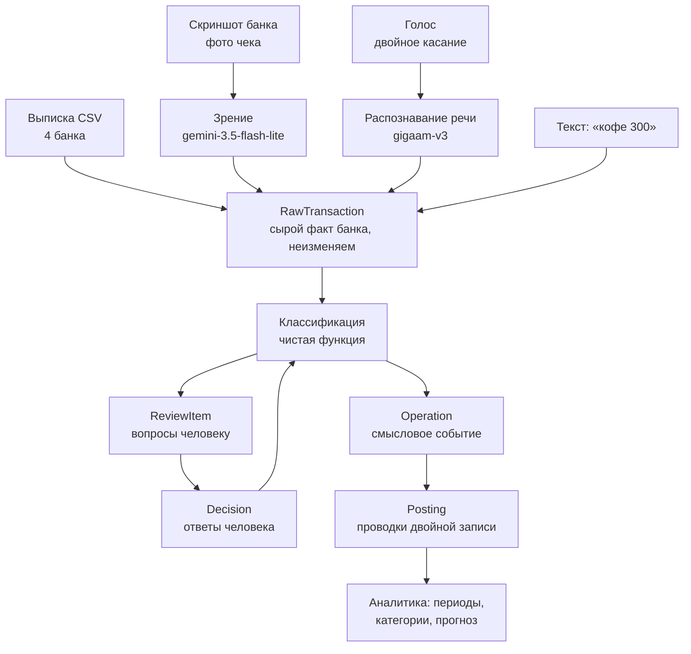

# PITCH_BRIEF — фактура для видео-презентации

Собрано для агента, у которого нет доступа к коду. Всё, что ниже, подтверждается
файлами репозитория или выводом команд — источник указан в скобках. Там, где
факта в репозитории нет, стоит **TODO: уточнить у команды**.

Формат ролика: 3 минуты, 16:9, только текст на экране, музыка и звуки, без голоса.

---

## 1. Коротко

| | |
|---|---|
| **Название** | Честный месяц |
| **Что это** | Трекер личных финансов в Telegram, который считает не «сколько списал банк», а сколько человек потратил на самом деле |
| **Хакатон** | CU@Hack (`data/Кейс 3. Честный месяц.pdf`) |
| **Кейс** | Кейс 3 «Честный месяц» |
| **Репозиторий** | `https://github.com/Ivanaki/CU_Hack`, ветка `honest-month` |
| **Демо** | Telegram-бот `@ICEQ_cu_hackBot`; Mini App открывается кнопкой из бота |
| **Публичный адрес** | `https://grosh.cu3rd.ru` — постоянный, сервис поднят на выделенном хосте и перезапускается сам |
| **Маскот** | Грош — золотая монета с лицом, нарисован инлайновым SVG в `miniapp/dist/index.html` |

Форма продукта: бот Telegram + Mini App внутри него. Отдельного сайта и мобильного
приложения нет.

---

## 2. Задача

**Формулировка кейса** (дословно из `data/Кейс 3. Честный месяц.pdf`):

> Инструмент учёта личных финансов, которым легко пользоваться регулярно. Две
> части задачи равнозначны: 1) добавлять операции должно быть удобно настолько,
> чтобы человек не бросил это делать; 2) аналитика трат за произвольный период
> должна быть точной: день, неделя, месяц, год.

**Боль и у кого.** Кейс описывает две группы существующих приложений, и обе не
решают задачу:

- **ручной ввод** — цифры точные, но требуют ежедневных действий, и пользоваться
  перестают быстро: «усилие на ведение превышает пользу от результата»;
- **автоматический импорт** — вводить ничего не надо, но данные
  классифицируются неверно: перевод между своими счетами отражается расходом,
  возврат долга доходом, оплата за компанию завышает траты. Формулировка кейса:
  «Ошибка в цифрах обнуляет доверие ко всей аналитике».

Решение обязано удерживать три свойства одновременно: минимум усилий,
корректные цифры, регулярное использование.

**Семь сценариев, на которых ломается автоматическая классификация** (из кейса,
это же список для демонстрации):

1. перевод 10 000 ₽ между своими картами разных банков;
2. пополнение карты банка маркетплейса на 6 000 ₽ и последующие траты по ней;
3. выдача долга 3 000 ₽ и возврат двумя частями по 1 500 ₽ с интервалом в неделю;
4. оплата счёта 8 000 ₽ за пять человек и четыре поступления по 1 600 ₽;
5. поступление 500 ₽ «за обед» без зафиксированного долга;
6. возврат товара, 4 200 ₽ приходят обратно на карту;
7. снятие 5 000 ₽ в банкомате.

**Что снижает оценку** (дословный список из кейса — по сути это критерии):

- добавление операции требует нескольких шагов там, где хватает одного;
- инструмент требует ручного занесения каждой операции;
- возврат долга или перевод между своими счетами отражается доходом или расходом;
- суммы недельных срезов не складываются в месячный;
- механика привычки описана в презентации, но отсутствует в продукте;
- демонстрация на наборе без сценариев из списка.

**Что сдать** (из кейса): работающий инструмент, набор транзакций для
демонстрации (ориентир — от 50 операций), экран итогов за период, названное
число действий пользователя в день, питч с демонстрацией.

**Заказчик кейса:** в PDF не назван. **TODO: уточнить у команды.**
**Лимит времени на питч:** в кейсе не записан. В `docs/DEMO.md` сценарий показа
рассчитан на 3–4 минуты. **TODO: уточнить у команды** официальный регламент.

---

## 3. Решение

1. **Считает потраченное, а не списанное.** Переводы себе, снятия наличных,
   выдача и возврат долгов, доля за компанию не попадают в расходы. Это не
   договорённость, а проверяемый инвариант: типы операций из множества
   `_NEUTRAL` по построению не создают проводок в расходные счета
   (`app/models/enums.py`, тест `check_neutral_kinds_have_no_expense`).
2. **Не выдумывает категории.** Когда непонятно, что за операция, продукт
   спрашивает, а не угадывает. Непонятные деньги видны отдельной суммой
   «не разобрано», а не растворяются в «прочем».
3. **Добавление операции — одно действие.** Двойное касание по задней панели
   iPhone: снимок экрана банка и голосовая записка улетают в приложение сами,
   без открывания чатов. Плюс выписка файлом, скриншот, голос и текст в бота.
4. **Суммы сходятся между периодами.** Недельные срезы складываются в месячный
   до копейки — следствие двойной записи, а не подгонки.
5. **Механика регулярности живёт в продукте**: процент осознанности, серия дней,
   уровни и задания, вечернее напоминание с характером от маскота.

**Чем сильнее очевидных решений.** Очевидное решение — взять выписку и
разложить по категориям по MCC-коду. На семи сценариях кейса оно даёт неверный
ответ в каждом: перевод себе станет и расходом, и доходом; возврат долга —
доходом; счёт за компанию завысит траты в пять раз. Здесь вместо этого лежит
двойная запись: у каждой операции сумма проводок равна нулю, поэтому
«недели складываются в месяц» — не результат аккуратности, а свойство модели,
которое нельзя нарушить, не сломав запись.

Второе отличие — честность вместо полноты: метрика осознанности округляется
не в свою пользу и не показывает 100 %, пока хоть что-то не разобрано.

---

## 4. Как работает

### Сценарий пользователя по шагам

| Шаг | Что делает человек | Что видит |
|---|---|---|
| 1 | Открывает бота, жмёт `/start` | Две строки и кнопка «Открыть приложение» |
| 2 | Присылает выписку CSV файлом в чат | Сколько строк разобрано и сколько появилось вопросов |
| 3 | Или: дважды стучит по задней панели iPhone | Снимок экрана банка уходит сам, в ответ — сколько операций распозналось |
| 4 | Или: диктует «кофе триста рублей» | Распознанный текст и записанная трата |
| 5 | Открывает Mini App | Процент осознанности, серия дней, траты за месяц, категории |
| 6 | Идёт в «Вопросы» | «Перевод Дмитрий К. на 25 000 ₽ — что это?» и варианты в один тап |
| 7 | Отвечает | Карточка уезжает, процент растёт на глазах |
| 8 | Вечером | Напоминание от Гроша с сегодняшним процентом |

### Архитектура



**Три слоя данных** (`app/models/models.py`):

- `RawTransaction` — строка из банка как есть, неизменяема;
- `Operation` — смысловое событие, склеенное из одной или нескольких строк;
- `Posting` — проводка двойной записи, единственный источник для аналитики.

**Ключевое решение:** классификация — чистая функция от пары (сырые строки,
решения пользователя). При каждом запуске операции, проводки и вопросы
пересобираются с нуля. Поэтому ответ, данный позже, корректно переписывает
прошлое, а порядок поступления данных на результат не влияет
(`app/classify/pipeline.py`).

**Стек** (`README.md`, `pyproject.toml`): Python 3.11, FastAPI + uvicorn,
aiogram 3 (long polling), SQLAlchemy 2, SQLite. Mini App — один
самодостаточный HTML-файл без сборщика, ~156 тыс. знаков.

**Модели и API** (`.env.example`):

| Роль | Модель | Провайдер |
|---|---|---|
| Зрение (скриншоты, чеки) | `google/gemini-3.5-flash-lite` | polza.ai, OpenAI-совместимый |
| Быстрый текст | `google/gemini-3.5-flash-lite` | polza.ai |
| Сложный разбор | `anthropic/claude-sonnet-5` | polza.ai |
| Речь | `ai-sage/gigaam-v3` | polza.ai |

Запасные модели зрения и речи настроены цепочкой: при отказе провайдера
разбор переходит к следующей, общий бюджет времени — 25 секунд
(`app/config.py`).

**Интеграции:** банковских API нет и по условиям кейса они не требуются.
Вход данных — файлы, картинки, голос, текст.

**Объём кода:** 49 файлов в `app/`, 14 396 строк (`find app -name "*.py" | wc -l`,
`find app -name "*.py" -exec cat {} + | wc -l`).

---

## 5. Демо

### Как запустить локально

```bash
python -m venv .venv
pip install -e ".[dev]"
cp .env.example .env            # заполнить BOT_TOKEN и ключ LLM

python -m scripts.gen_dataset   # соберёт демо-набор в data/demo
python -m scripts.seed --reset  # зальёт набор и напечатает итоги сентября
python -m app.main              # бот + API на :8080
```

`python -m app.main --api` поднимает только HTTP API, `--bot` — только бота.
На Windows перед `scripts.seed` нужно задать `PYTHONIOENCODING=utf-8`, иначе
печать падает на символе «₽» (`docs/DEMO.md`).

**Тестовый вход.** Пока `BOT_TOKEN` пуст, экран итогов открывается по
`http://localhost:8080/?tg_id=1`. При запущенном боте этот путь закрыт
(проверяется подпись Telegram), и Mini App открывается кнопкой из бота.

**Ловушка при перезаливке набора.** `scripts/seed.py --reset` пересоздаёт файл
базы, а работающий процесс продолжает держать прежний — SQLite отдаёт открытый
дескриптор, даже когда файл заменён. Экран при этом показывает пустоту при
полной базе. После `--reset` всегда перезапускать сервис
(`docker compose restart` или перезапуск `python -m app.main`).

**Развёрнутый стенд.** Для записи ролика ничего поднимать не нужно: рабочий
сервис доступен по `https://grosh.cu3rd.ru`, бот `@ICEQ_cu_hackBot` отвечает
круглосуточно. Данные там — только сгенерированный демо-набор.

**Демо-данные** (`data/demo/`, генерируются `scripts/gen_dataset.py`):

- `tbank_2026-07_09.csv` — 100 строк, июль–сентябрь 2026;
- `alfa_2026-09.csv`, `wildberries_2026-09.csv`, `cash_voice_2026-09.csv`;
- `screenshot_tbank.png` — эталонный скриншот банка для показа зрения;
- всего 104 операции, три банка, кошелёк маркетплейса и наличные; все семь
  сценариев кейса — в сентябре.

### Экраны и роуты

Mini App, четыре вкладки внизу экрана (`miniapp/dist/index.html`):

| Вкладка | Что на ней |
|---|---|
| **Месяц** | Кольцо осознанности, уровень, серия дней, блок «Добавить операции» (выписка, скриншот, наличные, настройка двойного касания), забег до конца месяца, советы Гроша |
| **Отчёты** | Недели, категории, обязательное против необязательного, прогноз, сравнение с прошлым периодом, список операций |
| **Вопросы** | Очередь спорных операций, ответ в один тап, поле «Своими словами» |
| **Награды** | Тропа месяца по станциям, уровни, достижения, партнёрские задания |

HTTP API (`GET /openapi.json` на запущенном сервере) — 30 маршрутов, основные:

```
GET  /healthz
POST /upload                              приём файла с быстрой команды iPhone
GET  /files, GET /files/{filename}
GET  /api/v1/me/summary                   итоги периода
GET  /api/v1/me/analytics                 разрезы и срезы
GET  /api/v1/me/operations                список операций
GET  /api/v1/me/questions                 очередь вопросов
POST /api/v1/me/questions/{id}/answer     ответ, в том числе своими словами
POST /api/v1/me/statements, /me/images    заливка выписки и картинок
GET  /api/v1/me/game                      уровень, задания, достижения
GET  /api/v1/me/checkup                   пересчёт и проверка инвариантов
GET/POST/DELETE /api/v1/me/places         свои названия мест
GET  /api/v1/me/upload-link               личный ключ для быстрой команды
GET  /api/v1/me/imports                   что человек присылал и что из этого вышло
POST /api/v1/quick/tap, GET /quick/card   виджет на рабочем столе
POST /api/v1/ingest/*                     служебный приём по ключу
```

Команды бота: `/start`, `/help`, `/month`, `/week`, `/questions`, `/link`,
`/checkup`, `/streak`.

### Лучший демо-сценарий

Подробный тайминг лежит в `docs/DEMO.md`. Самое сильное по порядку:

1. **Сходимость на глазах.** Открыть «Отчёты» на демо-наборе: недельные срезы
   складываются в месячный до копейки. На развёрнутом стенде `grosh.cu3rd.ru`
   сейчас **105 операций, сентябрь 2026 — 128 618,20 ₽, осознанность 97 %,
   два открытых вопроса** (проверено запросом к `/api/v1/me/summary`).

   Цифра месяца зависит от даты показа, и это поведение модели, а не сбой:
   из снятых 9 сентября 5 000 ₽ объяснено 2 000, остаток признаётся тратой
   через 14 дней (`CASH_UNALLOCATED_AFTER_DAYS`). До 23 сентября месяц
   показывает 125 618,20 ₽, после — 128 618,20 ₽. Верны обе; называть надо
   ту, что на экране (`docs/DEMO.md`).

2. **Скриншот банка.** Перетащить `data/demo/screenshot_tbank.png` в бота:
   **8 операций распознаётся за 6–9 секунд**, из них две поднимают вопросы.

3. **Голос.** Надиктовать «кофе триста рублей» — **распознаётся за 2–3 секунды**,
   трата записывается, в ответе видно распознанный текст.

4. **Вопрос и рост процента.** В «Вопросах» ответить на «Перевод Дмитрий К. на
   25 000 ₽ — что это?». На чистом наборе из двух операций это даёт переход
   **осознанность 6 % → 100 %, не разобрано 25 000 ₽ → 0 ₽** (проверено на
   боевом адресе).

5. **Два банка сходятся сами.** Залить выписку Т-Банка, показать неразобранные
   10 500 ₽, затем залить выписку Альфы — остаётся 500 ₽: система склеила
   перевод между своими счетами из двух половин.

6. **Свои названия мест.** В списке операций нажать «Назвать по-своему» на
   `InterFood`, написать «Узбечка» — переименовываются обе прошлые траты и все
   будущие. Проверено на живых данных: `applied: 2`.

**Самая эффектная цифра — на настоящей выписке участника команды** (Т-Банк,
июнь–сентябрь 2026, 504 строки → 498 операций):

> банк насчитал бы за сентябрь **260 707,63 ₽**, на самом деле потрачено
> **60 707,63 ₽**. Разница — 200 000 ₽ собственных переводов между своими
> счетами, которые банк считает тратами.

Это не демо-набор, а реальная выгрузка. **TODO: уточнить у команды**, можно ли
показывать эти числа публично.

---

## 6. Цифры и результаты

Только измеренное, с источником.

| Показатель | Значение | Источник |
|---|---|---|
| Автотестов | **339 зелёных** | `python -m pytest -q` |
| Из них на сценарии кейса | 11 | `tests/test_scenarios.py` |
| Из них на сходимость периодов | 7 | `tests/test_additivity.py` |
| Сквозных проверок боевого сервера | **34, провалов 0** | `python -m scripts.smoke --base <адрес>` |
| Демо-набор | 104 операции, 3 банка + кошелёк + наличные | `scripts/gen_dataset.py`, `data/demo/` |
| Реальная выписка участника | 504 строки → 498 операций | прогон `ingest_statement` |
| Скриншот банка | 8 из 8 операций за 6–9 с | `scripts/bench_vision.py`, живые прогоны |
| Голосовая записка | «Кофе 300 ₽» за 2–3 с | `app/asr/transcribe.py`, живые прогоны |
| Типов операций в модели | 15 | `app/models/enums.py` |
| Категорий | 31 (25 расходных, 6 доходных) | `app/classify/categories.py` |
| Строк кода в `app/` | 14 396 в 49 файлах | `find app -name "*.py"` |
| Партнёрских заданий в коде | 4 оффера | `app/gamification.py`, `PARTNER_QUESTS` |

**Названное число действий пользователя в день** (этого требует кейс):
один–два тапа. Считается в продукте: `average_actions_per_day`, видно по
команде `/streak` (`README.md`).

**Экономика на пользователя в месяц** — расчёт из презентации `pitch2/`:
расход на ИИ 8,01 ₽ сырой (≈16 ₽ с двойным запасом на повторы), выручка
25,95 ₽ (9,95 подписка + 16 реклама), маржа +9,95 ₽. Размер промпта и время
разбора измерены, **цены провайдера — допущение**, в репозитории их нет, и на
слайде это помечено явно.

---

## 7. Честно: что работает, а что нет

**Работает полностью, проверено на живых данных:**

- разбор выписок CSV четырёх банков, определение банка по формату;
- разбор скриншота банка и фото чека языковой моделью зрения;
- распознавание голосовых записок;
- все семь сценариев кейса;
- склейка переводов между банками из двух выписок;
- двойная запись и сходимость периодов;
- вопросы, ответ в один тап и свободным текстом;
- быстрая команда iPhone по двойному касанию: установка, активация, отправка
  скриншота и голоса;
- разделение пользователей: чужую книгу не видно ни в каком виде;
- уровни, серия дней, задания, достижения, вечернее напоминание;
- свои названия мест с применением к прошлым операциям.

**Ограничения, которые честнее назвать самим:**

- **Хост общий.** Сервис живёт на выделенной машине во Франкфурте
  (`grosh.cu3rd.ru`, Docker, перезапуск автоматический), но её ресурсы —
  4 ядра и 8 ГБ — делятся с чужими сервисами, на ней крутится ещё около
  десятка контейнеров. Возможны просадки скорости не по нашей вине.
- **Первый хост команды до Telegram не достаёт** — блокирует провайдер,
  проверено и из контейнера, и с хоста. Поэтому продукт и переехал; на
  прежней машине бот работать не мог в принципе.
- **Провайдер ИИ нестабилен.** polza.ai периодически отдаёт 503. Цепочка
  запасных моделей и бюджет в 25 секунд это закрывают: продукт честно отвечает
  «файл принял, разобрать не смог» вместо зависания.
- **Партнёрские задания — четыре зашитых оффера**, а не работающая рекламная
  сеть. Прогресс по ним считается из настоящих проводок, но сами офферы
  написаны в коде.
- **Интеграции с банками нет** — по условиям кейса она не требуется и не
  оценивается.
- **Порог вопроса про место — 1 000 ₽.** Более мелкие неопознанные траты
  вопроса не поднимают, поэтому осознанность может стоять на 97 %, а вопросов
  не быть. Это решение, а не ошибка: дёргать человека из-за четырёхсот рублей
  дороже, чем оставить три процента.

Моков и заглушек, выдаваемых за работающее, в продукте нет. Единственный
запасной набор — данные экрана, которые показываются, когда API недоступен, и
он явно помечен на экране надписью «Демонстрационные данные».

---

## 8. Ценность и что дальше

**Для пользователя.** Человек перестаёт спорить с приложением. Он видит сумму,
которой можно верить, и тратит на это один–два тапа в день вместо ежедневного
занесения операций. Цифра, ради которой всё затеяно: банк показал бы 260 тысяч,
честно потрачено 60.

**Для заказчика.** Кейс требует трёх свойств одновременно — минимум усилий,
корректные цифры, регулярное использование. Продукт закрывает все три и
показывает это числами, а не словами: сходимость проверена тестами, механика
привычки живёт в коде, путь добавления операции измеряется одним действием.

**Масштабирование.** Классификация — чистая функция, состояние пересобирается
целиком, поэтому правила можно менять без миграций данных. Модель денег не
завязана на конкретный банк: новый формат выписки — это описание колонок.

**Планы после хакатона** (из плана презентации, `data/План.pdf` и `pitch2/`):

- деление чека между людьми;
- нативные приложения для iOS и Android — больше возможностей ввода;
- интеграция с банками напрямую;
- подписка и ультра-контекстная реклама как модель заработка.

---

## 9. Команда

В репозитории роли не записаны. Известно из истории работы:

- **Вячеслав** — быстрая команда iPhone и приём файлов;
- **chase** — виджет и проверка на живых данных;
- **Егор** — проверка на живых данных.

Владелец репозитория — `Ivanaki`. Коммиты идут от одного автора (`phantom`).

**TODO: уточнить у команды** полный состав, фамилии и роли для титров.

---

## 10. Стиль

**Название:** Честный месяц.

**Маскот:** Грош — золотая монета с лицом, руками и ногами. Нарисован
инлайновым SVG прямо в `miniapp/dist/index.html`, отдельного файла нет. Шесть
состояний настроения: `proud`, `sad`, `curious`, `hype`, `think`, `party`.
Готовые изображения маскота есть в презентации: `pitch2/img/` и сама
`pitch2/Честный-месяц.pdf` (8 слайдов, 16:9, 960×540 pt).

**Логотип:** отдельного файла логотипа нет. Аватарки: `miniapp/dist/art/avatar-1.png`
… `avatar-4.png`. Иконки категорий: `miniapp/dist/art/icon-*.png`.

**Цвета** — CSS-переменные из `:root` в `miniapp/dist/index.html`:

```css
--bg:#FBF0D9;        /* тёплый песочный фон */
--bg-2:#F3E4C6;
--card:#FFFCF4;      /* карточки */
--card-2:#F7EEDC;
--ink:#1B2430;       /* основной текст, он же цвет обводки */
--hint:#8C8474;      /* подписи */
--stroke:#1B2430;    /* обводка 2.5–3px у всех элементов */
--line:#E7D9BD;

--gold:#F5B93A;  --gold-d:#DFA226;  --gold-soft:#FCEFD0;   /* акцент, монета */
--green:#4CC86A; --green-d:#2FA854; --green-soft:#E1F6E7;  /* успех, осознанность */
--coral:#FF7A59; --coral-d:#E4573A; --coral-soft:#FFE8E1;  /* внимание, вопросы */
```

**Шрифт:** Nunito (Google Fonts), начертания жирные — базовый вес 700, заголовки
900. Запасные: системные `-apple-system`, `Segoe UI`, `Roboto`.

**Визуальный язык:** плотная чёрная обводка 2.5–3 px у каждого элемента, тень
блоком вниз (`box-shadow: 0 5px 0 var(--stroke)`), скругления 14–20 px, тёплый
фон с мягкими цветными пятнами и сеткой точек. Только светлая тема — тёмной в
продукте нет намеренно.

**Тон текста:** короткие утверждения, никакого канцелярита. **Эмодзи в
интерфейсе не используются — это правило продукта**, в ролике их тоже быть не
должно.

---

## 11. Что НЕ показывать и не писать

**Секреты — никогда, ни в кадре, ни в тексте:**

- `BOT_TOKEN` бота Telegram;
- ключ провайдера ИИ (`LLM_API_KEY`), ключи `INGEST_API_KEY`, `UPLOAD_API_KEY`;
- персональные ключи загрузки — строки вида `fm_…`;
- содержимое файла `.env` целиком.

**Персональные данные:**

- реальные выписки участников и суммы из них без разрешения (см. TODO в
  разделе 5);
- фамилии и имена контрагентов из настоящих переводов — в демо-наборе они
  выдуманы, в живых данных нет;
- telegram id участников;
- скриншоты чужих книг.

**Недоделанное, о чём не стоит заявлять:**

- интеграция с банками — её нет;
- партнёрская рекламная сеть — в коде четыре зашитых оффера;
- «наш собственный сервер» — машина общая, ресурсы делятся с чужими сервисами;
- «выдерживает нагрузку» — нагрузочного тестирования не проводилось.

**Не показывать в кадре:** терминал с содержимым `.env`, ответы API с полем
`token`, адресную строку с параметром `?token=`.

---

## Семь тезисов для питча

1. Трекеры делятся на два вида: ручные бросают через неделю, автоматические
   врут в цифрах. Мы сделали третий.
2. На реальной выписке банк насчитал бы 260 707 ₽ — честно потрачено 60 707 ₽.
   Разница в 200 тысяч — это переводы между своими же счетами.
3. Недели складываются в месяц до копейки, и это не аккуратность, а двойная
   запись: нарушить нельзя, не сломав саму запись.
4. Продукт не выдумывает категории. Когда непонятно — спрашивает, и непонятные
   деньги видны отдельной суммой.
5. Добавление операции — одно действие: двойное касание по задней панели
   iPhone, дальше скриншот банка и голос улетают сами.
6. Механика привычки живёт в коде, а не на слайде: процент осознанности, серия
   дней, вечернее напоминание с характером.
7. 339 тестов, 34 сквозные проверки боевого сервера, все семь сценариев кейса —
   на настоящих данных, а не на подготовленных.
