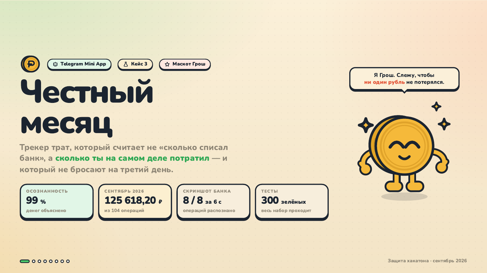
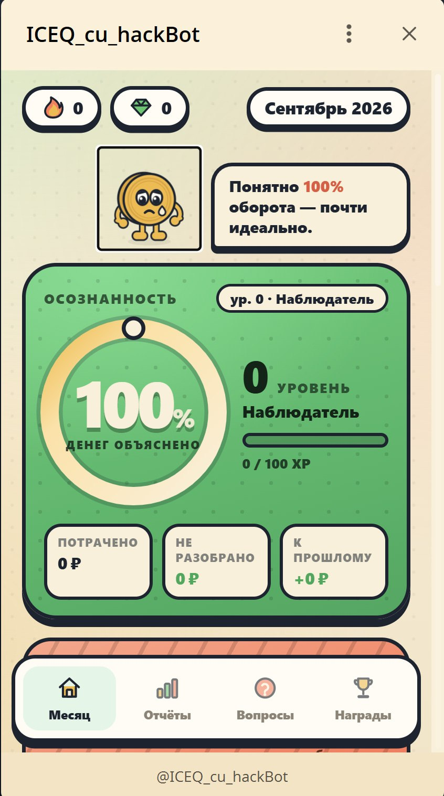
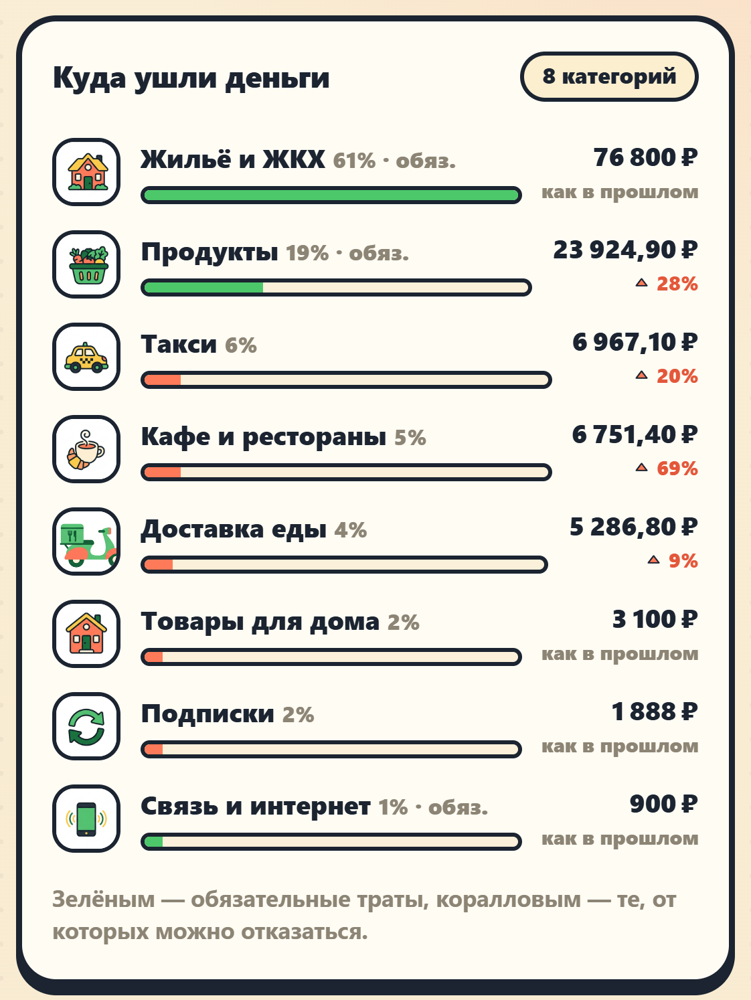
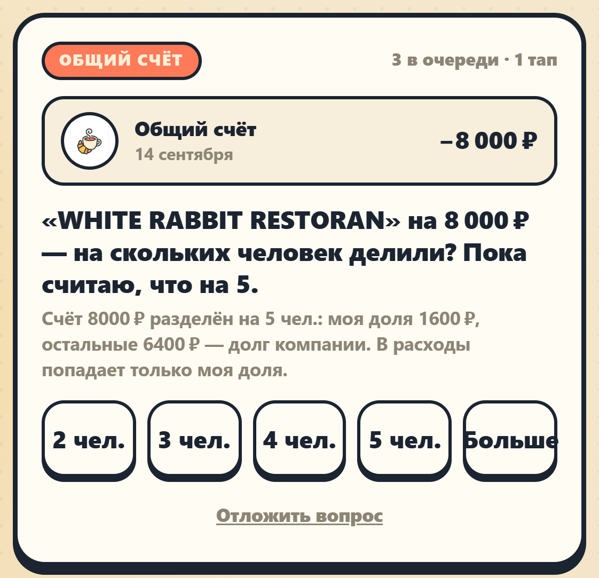
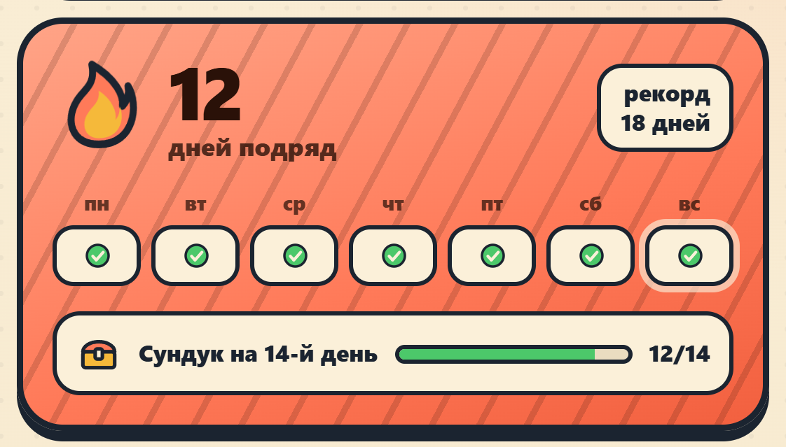

<p align="center">
  
</p>

<h1 align="center">Honest Month · Честный месяц</h1>

<p align="center"><b>Understand your spending. Build a habit.</b><br>A Telegram bot and Mini App that distinguish real expenses from money simply moving between accounts.</p>

<p align="center">
  
  
  
  
  
</p>

<p align="center">
  <b>English</b> · <a href="README.ru.md">Русский</a><br>
  <a href="https://t.me/ICEQ_cu_hackBot">Telegram bot</a> · <a href="pitch2/Честный-месяц.pdf">Presentation</a> · <a href="docs/media/pitch.mp4">Watch the pitch · 2:56</a> · <a href="#quick-start">Quick start</a> · <a href="#inside-the-backend">Code tour</a>
</p>

## The idea

Bank debits do not always mean spending. A transfer to your own card, a cash withdrawal or a friend repaying a debt should not inflate an expense report. A shared restaurant bill should count only your share.

**Honest Month** brings statement imports, screenshots, receipts and cash entries into one accounting engine. Rules handle known cases; ambiguous transactions become short questions. The Mini App shows spending, unresolved amounts and a **financial awareness score**: how much of the money movement has been explained.

Built for **case 3 at CU@Hack, Central University**. The team created the initial working prototype in **six hours**, took **first place** and qualified for the university hackathon team. **Vyacheslav Samuilenko / [Ivanaki](https://github.com/Ivanaki)** participated in the project.

## A look inside

| Month dashboard | Spending categories | Questions | Daily habit |
| :---: | :---: | :---: | :---: |
|  |  |  |  |

Screens show the prototype and demonstration data. The cover is from the hackathon presentation; its figures are the results reported for that demonstration.

### Less bookkeeping, more clarity

| Capability | Implementation |
| --- | --- |
| **Import transactions** | CSV statement formats, screenshot and receipt recognition, duplicate detection. |
| **Record cash spending** | Text such as `coffee 300`, or voice transcription through a configured speech provider. |
| **Resolve uncertainty** | A review queue for shared bills, unclear receipts of money and other ambiguous cases. |
| **See the month clearly** | Category and weekly breakdowns, debts, account balances and month-end projections. |
| **Keep the habit** | Grosh the mascot, streaks, freezes, XP, achievements, reminders and partner quests. |
| **Capture from iPhone** | A Shortcut can send screenshots and audio to the upload API using a personal upload token. |

### What counts as an expense?

| Money movement | How the engine treats it |
| --- | --- |
| Transfer between your own accounts | A transfer; any bank fee is treated separately. |
| Cash withdrawal / marketplace wallet top-up | Movement between forms of money, with spending recognised separately. |
| Lending money / receiving repayment | A debt and its settlement. |
| Paying for a group | Your share is an expense; the rest is a receivable. |
| Refund / unclear incoming payment | Matched or sent for review rather than silently treated as ordinary income. |

## Inside the backend

The bot and Mini App use a shared service layer. Raw transactions and user decisions are retained; classification rebuilds operations, ledger postings and review items from those inputs. Monetary amounts use **integer kopecks**, and the ledger has explicit balance and neutrality checks.

| Area | Start reading |
| --- | --- |
| **Application & shared use cases** | [app/main.py](app/main.py) · [app/service.py](app/service.py) |
| **Statement and image ingestion** | [app/ingest/base.py](app/ingest/base.py) · [app/ingest/vision.py](app/ingest/vision.py) |
| **Classification & recalculation** | [app/classify/pipeline.py](app/classify/pipeline.py) |
| **Double-entry ledger & invariants** | [app/ledger/build.py](app/ledger/build.py) · [app/ledger/invariants.py](app/ledger/invariants.py) |
| **Reports & periods** | [app/analytics/reports.py](app/analytics/reports.py) · [app/analytics/periods.py](app/analytics/periods.py) |
| **API, identity & uploads** | [app/api/auth.py](app/api/auth.py) · [app/api/uploads.py](app/api/uploads.py) |
| **Habit mechanics** | [app/gamification.py](app/gamification.py) · [app/bot/scheduler.py](app/bot/scheduler.py) |
| **Scenario & consistency tests** | [tests/test_scenarios.py](tests/test_scenarios.py) · [tests/test_additivity.py](tests/test_additivity.py) |

### Stack

| Category | Tools |
| --- | --- |
| Language | Python 3.11+ |
| Backend & bot | FastAPI · uvicorn · aiogram 3 · APScheduler |
| Data & configuration | SQLAlchemy 2 · SQLite · Pydantic Settings |
| Mini App | HTML · CSS · JavaScript · Telegram Web Apps |
| AI integrations | OpenAI-compatible vision and speech APIs, with configurable providers and fallbacks |
| Deployment & verification | Docker Compose · systemd · pytest |

## Quick start

Requires **Python 3.11+**. Run from the repository root:

```bash
git clone https://github.com/Ivanaki/CU_Hack.git
cd CU_Hack
python -m venv .venv
source .venv/bin/activate
pip install -r requirements.txt
cp .env.example .env
```

On Windows PowerShell, activate with `.venv\Scripts\Activate.ps1` and copy the configuration with `Copy-Item .env.example .env`.

For an API-only local start, set `LLM_PROVIDER=none` and `ASR_PROVIDER=none` in `.env`, then run:

```bash
python -m app.main --api
```

Open **[localhost:8080](http://localhost:8080)** for the Mini App shell and **[localhost:8080/docs](http://localhost:8080/docs)** for the API reference. Personal Mini App endpoints use Telegram identity. The health check is `GET /healthz`.

| Mode | Configuration / command |
| --- | --- |
| **Bot + API** | Set `BOT_TOKEN`, then run `python -m app.main`. Set `MINIAPP_URL` to the HTTPS address used by Telegram. |
| **Vision / speech** | Configure provider credentials in `.env`; see [.env.example](.env.example). CSV imports and text entries do not require these providers. |
| **Demo data** | In a fresh local database, run `python -m scripts.seed`, then `python -m scripts.dump`. |
| **Docker** | After configuring `.env`, run `docker compose up -d --build`. |
| **Tests** | Install `pytest pytest-asyncio freezegun`, then run `python -m pytest -q`. |

## Documentation & project materials

- **[Technical guide, in Russian](DEVELOPMENT.ru.md)** — detailed setup, transaction flows and the case scenarios.
- **[Architecture](ARCHITECTURE.md)** · **[HTTP API](docs/API.md)** · **[Demo walkthrough](docs/DEMO.md)**.
- **[Deployment](deploy/README.md)** · **[iPhone Shortcut](widget/SHORTCUT.md)**.
- **[Presentation PDF](pitch2/Честный-месяц.pdf)** · **[Video pitch](docs/media/pitch.mp4)**.

Direct bank API integrations and native mobile apps are next-step ideas from the presentation. The current prototype uses imported files, screenshots, voice and text.
