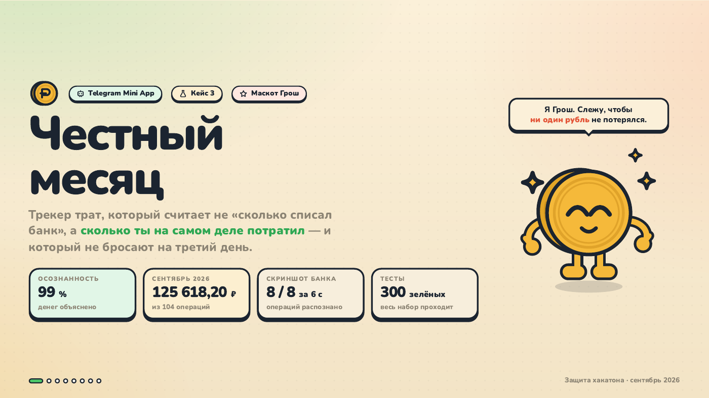
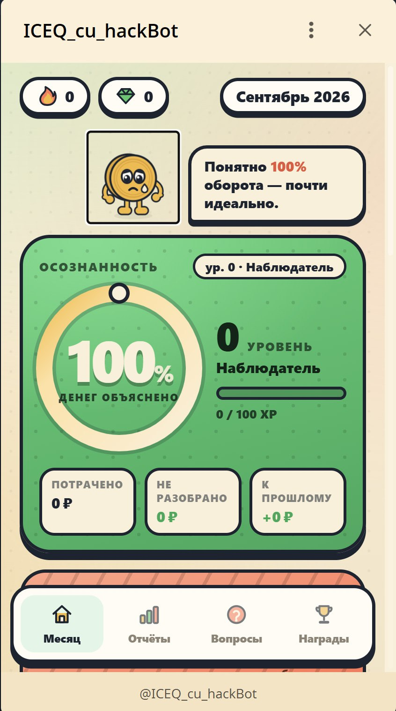
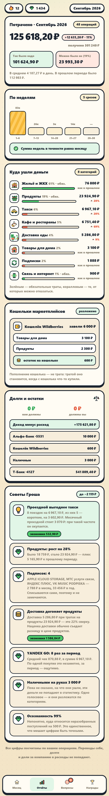
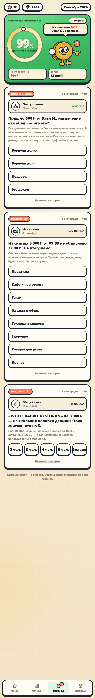
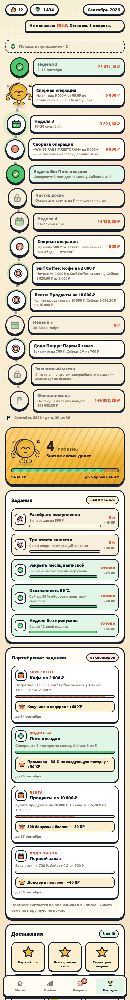

<p align="center">
  
</p>

<h1 align="center">Честный месяц · Honest Month</h1>

<p align="center"><b>Понимать свои траты. Сохранять привычку.</b><br>Telegram-бот и Mini App, которые отличают реальные расходы от перемещения денег между счетами.</p>

<p align="center">
  
  
  
  
  
</p>

<p align="center">
  <a href="README.md">English</a> · <b>Русский</b><br>
  <a href="https://t.me/ICEQ_cu_hackBot">Telegram-бот</a> · <a href="pitch2/Честный-месяц.pdf">Презентация</a> · <a href="docs/media/pitch.mp4">Видеопитч · 2:56</a> · <a href="#быстрый-запуск">Запуск</a> · <a href="#как-устроен-backend">Обзор кода</a>
</p>

## Идея проекта

Списание с карты не всегда означает расход. Перевод себе, снятие наличных и возврат долга не должны увеличивать сумму трат. В общем ресторанном счёте расходом должна стать только собственная доля.

**«Честный месяц»** объединяет выписки, скриншоты, чеки и записи наличных в одном учётном движке. Знакомые случаи разбирают правила, спорные превращаются в короткие вопросы. Mini App показывает расходы, неразобранные суммы и **процент финансовой осознанности** — насколько объяснено движение денег.

Проект создан для **кейса 3 на CU@Hack в Центральном университете**. Команда собрала первый работающий прототип за **шесть часов**, заняла **первое место** и прошла в сборную университета по хакатонам. Участник проекта — **Вячеслав Самуйленко / [Ivanaki](https://github.com/Ivanaki)**.

## Как выглядит приложение

| Месяц | Отчёты | Вопросы | Награды |
| :---: | :---: | :---: | :---: |
|  |  |  |  |

На экранах показаны прототип и демонстрационные данные. Обложка взята из презентации хакатона; числа на ней — результаты, приведённые для той демонстрации.

### Меньше ручного учёта, больше ясности

| Возможность | Реализация |
| --- | --- |
| **Загрузка операций** | Форматы CSV-выписок, распознавание скриншотов и чеков, поиск дублей. |
| **Учёт наличных** | Текст вроде `кофе 300` или голосовое с распознаванием через настроенного провайдера. |
| **Разбор спорных случаев** | Очередь вопросов об общих счетах, непонятных поступлениях и других неоднозначных операциях. |
| **Понятный месяц** | Категории, недельные срезы, долги, остатки по счетам и прогноз до конца месяца. |
| **Привычка** | Маскот Грош, стрики, заморозки, XP, достижения, напоминания и партнёрские задания. |
| **Отправка с iPhone** | Быстрая команда отправляет скриншоты и аудио в API с личным токеном загрузки. |

### Что считается расходом

| Движение денег | Как его обрабатывает движок |
| --- | --- |
| Перевод между своими счетами | Перевод; комиссия банка учитывается отдельно. |
| Снятие наличных / пополнение кошелька маркетплейса | Перемещение между формами денег; сами траты учитываются отдельно. |
| Выдача денег в долг / возврат | Долг и его погашение. |
| Оплата за компанию | Собственная доля — расход, остальное — задолженность других участников. |
| Возврат покупки / непонятное поступление | Сопоставление или вопрос пользователю вместо автоматической записи в обычный доход. |

## Как устроен backend

Бот и Mini App используют общий сервисный слой. Исходные транзакции и решения пользователя сохраняются; классификация пересобирает из них операции, проводки и вопросы. Деньги хранятся в **целых копейках**, у книги есть явные проверки баланса и нейтральности переводов.

| Область | С чего начать просмотр |
| --- | --- |
| **Приложение и общие сценарии** | [app/main.py](app/main.py) · [app/service.py](app/service.py) |
| **Импорт выписок и изображений** | [app/ingest/base.py](app/ingest/base.py) · [app/ingest/vision.py](app/ingest/vision.py) |
| **Классификация и пересчёт** | [app/classify/pipeline.py](app/classify/pipeline.py) |
| **Двойная запись и инварианты** | [app/ledger/build.py](app/ledger/build.py) · [app/ledger/invariants.py](app/ledger/invariants.py) |
| **Отчёты и периоды** | [app/analytics/reports.py](app/analytics/reports.py) · [app/analytics/periods.py](app/analytics/periods.py) |
| **API, идентификация и загрузки** | [app/api/auth.py](app/api/auth.py) · [app/api/uploads.py](app/api/uploads.py) |
| **Механика привычки** | [app/gamification.py](app/gamification.py) · [app/bot/scheduler.py](app/bot/scheduler.py) |
| **Тесты сценариев и сходимости** | [tests/test_scenarios.py](tests/test_scenarios.py) · [tests/test_additivity.py](tests/test_additivity.py) |

### Технологии

| Категория | Инструменты |
| --- | --- |
| Язык | Python 3.11+ |
| Backend и бот | FastAPI · uvicorn · aiogram 3 · APScheduler |
| Данные и конфигурация | SQLAlchemy 2 · SQLite · Pydantic Settings |
| Mini App | HTML · CSS · JavaScript · Telegram Web Apps |
| Интеграции ИИ | OpenAI-совместимые API зрения и речи с настройкой провайдеров и запасных моделей |
| Развёртывание и проверки | Docker Compose · systemd · pytest |

## Быстрый запуск

Нужен **Python 3.11+**. Команды выполняются из корня репозитория:

```bash
git clone https://github.com/Ivanaki/CU_Hack.git
cd CU_Hack
python -m venv .venv
source .venv/bin/activate
pip install -r requirements.txt
cp .env.example .env
```

Для Windows PowerShell: активация — `.venv\Scripts\Activate.ps1`, копирование настроек — `Copy-Item .env.example .env`.

Для локального запуска только API задать `LLM_PROVIDER=none` и `ASR_PROVIDER=none` в `.env`, затем выполнить:

```bash
python -m app.main --api
```

**[localhost:8080](http://localhost:8080)** — оболочка Mini App, **[localhost:8080/docs](http://localhost:8080/docs)** — справочник API. Личные эндпоинты Mini App используют идентификацию Telegram. Проверка доступности — `GET /healthz`.

| Режим | Настройка / команда |
| --- | --- |
| **Бот + API** | Задать `BOT_TOKEN`, запустить `python -m app.main`. В `MINIAPP_URL` указать HTTPS-адрес для Telegram. |
| **Зрение / речь** | Настроить ключи провайдеров в `.env`; см. [.env.example](.env.example). CSV и текстовые записи работают без этих провайдеров. |
| **Демонстрационные данные** | На новой локальной базе выполнить `python -m scripts.seed`, затем `python -m scripts.dump`. |
| **Docker** | После настройки `.env` выполнить `docker compose up -d --build`. |
| **Тесты** | Установить `pytest pytest-asyncio freezegun`, затем выполнить `python -m pytest -q`. |

## Документация и материалы

- **[Техническое руководство](DEVELOPMENT.ru.md)** — подробный запуск, обработка операций и сценарии кейса.
- **[Архитектура](ARCHITECTURE.md)** · **[HTTP API](docs/API.md)** · **[Сценарий демонстрации](docs/DEMO.md)**.
- **[Развёртывание](deploy/README.md)** · **[Быстрая команда iPhone](widget/SHORTCUT.md)**.
- **[Презентация PDF](pitch2/Честный-месяц.pdf)** · **[Видеопитч](docs/media/pitch.mp4)**.

Прямые интеграции с API банков и нативные мобильные приложения — следующие шаги из презентации. Текущий прототип работает с импортом файлов, скриншотами, голосом и текстом.
